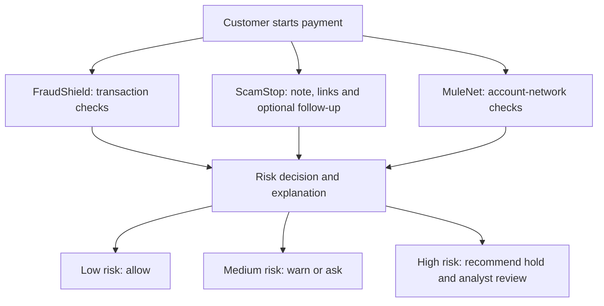

# Last Mile Guard

**A second look before the money moves.**

- **Goal:** Investigate scams and financial crime before a payment settles.
- **Solution:** Combine three checks, **FraudShield + ScamStop + MuleNet**, in one explainable risk decision.
- **Output:** Recommend **allow**, **warn/ask**, or **hold for human review**, with a score and ranked reasons. A person confirms every hold.
- **Stage:** Synthetic-data prototype for the Google Cloud AI Builder Cup 2026, BFSI track. No real bank or payment rail is connected.
- **Pitch:** [the idea in one page](docs/PITCH_IDEA.md).

## What each part does

1. **FraudShield (transaction behaviour):** Check amount, timing, device, payee, payment frequency, and recent payment history.
2. **ScamStop (customer manipulation):** Read the customer's note with Gemini for pressure, secrecy, or coaching; ask one follow-up round when the evidence is thin. Links in the note are checked as text only (shortened, look-alike, or payment-request links add risk) and are never opened.
3. **MuleNet (receiving-account risk):** Check account links to flagged accounts, many recent senders, and rapid onward transfers, on an optional, bounded synthetic graph.
4. **Risk decision and explanation:** Combine the evidence, rank the reasons, and recommend an action. The customer's warning can be shown in Hindi, Spanish, French, Portuguese or Arabic; the English warning stays as the record. A bank would make the final payment-control decision.

## Agent and decision flow



- **Current implementation:** One FastAPI service. FraudShield and MuleNet use explainable rules; ScamStop uses Gemini for structured message reading and question writing. Plain, testable rules choose the recommendation. Gemini never approves or holds a payment.
- **Target architecture:** A bank supplies trusted payment and account data, then controls warnings, holds, analyst review, and payment release. The diagram shows the intended flow; it does not imply a live bank integration.

## What works today

- **FraudShield:** Rule-based transaction and request-supplied history scoring in `backend/risk/behaviour.py`.
- **ScamStop:** Gemini-assisted note reading and one follow-up round, the link check in `backend/risk/links.py`, and deterministic decision rules in `backend/risk/`.
- **MuleNet:** Rule-based checks on an optional synthetic transfer graph in `backend/risk/network.py`.
- **API:** `POST /api/assess` returns a recommendation, score, ranked reasons, and audit breakdown. `POST /api/arena` streams a live red-team run, `POST /api/custom` plays a scenario a visitor describes, and `GET /api/health` checks the service.
- **Demo:** A live console with three modes (try one case, watch the red team, or describe your own scenario), a browser-only analyst queue, architecture and evidence pages.
- **Evaluation:** Synthetic scenarios, red-team tools, Pytest, and web unit tests.

## Testing against public fraud patterns

The scam cases in the live arena and the evaluation are modelled on fraud patterns described on public advice pages: the US Federal Trade Commission's consumer alerts and Australia's Scamwatch (ACCC). A careful reader (`redteam/intel/reports.py`) contacts only those named sites over https, follows each site's `robots.txt`, refuses redirects off the list, paces itself, and stops at a hard limit. It runs in Cloud Shell only and never saves page text. Gemini then writes an invented customer for each pattern, with made-up names and amounts, and each case records the page it was modelled on. The site shows that source and a link. UK Action Fraud is not used because its `robots.txt` asks automated readers to stay away. Scamwatch content is used under its Creative Commons Attribution licence.

Half of those cases are held back in a locked test set and run once. The results, including the weak ones and the faults we found and fixed in our own test data and in the message reader, are on the Evidence page. They are small samples and do not establish performance on bank data. MuleNet has unit tests and one demo scenario, but no measured evaluation yet.

## Google technology

- **Gemini via Vertex AI (implemented when configured):** Extract structured scam signals from notes and answers, draft up to two neutral questions, and translate the customer's warning. Gemini does not approve or hold payments.
- **Cloud Run (deployment included):** Serve the FastAPI API and React build in one container.
- **Cloud Build (deployment included):** Build the container during `gcloud run deploy --source`.
- **Cloud service account (deployment supported):** Give Cloud Run access to Vertex AI without a key file in the service.
- **Cloud Text-to-Speech (video only):** Narrate the explainer video in `video/`. Not in the payment path.
- **Pub/Sub (planned):** Receive authenticated payment events from a bank workflow.
- **BigQuery (planned):** Provide governed transaction, payee, and account-link history for scoring and evaluation.

## Tech stack

- **Web:** React, TypeScript, Vite, Vitest (`web/`).
- **API:** Python, FastAPI, Pydantic, Uvicorn (`backend/`).
- **AI:** Google Gen AI Python SDK and Gemini via Vertex AI (`backend/`).
- **Risk engine:** Explainable Python behaviour, scam, link, network, and decision rules (`backend/risk/`).
- **Deployment:** Docker and Cloud Run source deployment (`infra/`).
- **Video:** Remotion scenes and a Text-to-Speech script, built in Cloud Shell (`video/`).

## Safety and current limits

- The demo uses made-up payments, customer stories, and account links. The MuleNet graph arrives in the demo request; a production bank must source it from trusted records and bind it to the authenticated destination account. MuleNet only adds risk, so a supplied graph can never clear a payment.
- Customer text is untrusted. Model output is constrained to a schema, and scoring and action thresholds stay in testable code. Emails and card numbers are blocked before anything is sent to the model.
- The link check reads link text only and never opens or fetches a link. Translation applies only to the warning our rules wrote, never to the customer's words, and never changes the decision.
- A visitor's own scenario has its own limits (one a minute and a few an hour for each visitor), checks input in the browser and on the server, and never logs or returns the story text.
- The analyst queue exists only in browser state. No persistent case store, bank identity integration, or live payment hold or release mechanism exists. The API returns audit details but does not persist them.
- Gemini can be unavailable; the API then falls back to payment and network rules. Input limits, request limits and a Gemini call budget protect the demo.
- A calm, coached victim paying something ordinary can still get through. Synthetic and red-team results do not establish performance on real bank data.

## Next priorities

1. Bind each payment to trusted bank transaction and account-network data; replace request-supplied evidence in the production path.
2. Validate and calibrate combined scoring on held-back fraud, scam, mule, and legitimate cases.
3. Add authenticated analyst review, durable case and audit storage, and bank-controlled hold and release.
4. Add Pub/Sub ingestion, governed BigQuery lookups, monitoring, and automated CI checks.

## Run locally

1. Copy `.env.example` to an ignored `.env`; set `GEMINI_API_KEY` if you want Gemini message reading.
2. Start the API from the repository root:

   ```bash
   python -m pip install -r backend/requirements.txt
   python -m uvicorn backend.app:app --reload --port 8080
   ```

3. Start the web app in another terminal:

   ```bash
   cd web
   npm ci
   npm run dev
   ```

4. Run the tests: `python -m pytest backend/tests`; from `web/`, run `npm test`.

Our own team runs installs, cloud commands and server tests in Cloud Shell, not on laptops.

## Deploy the synthetic demo

- Configure the Google Cloud project, required APIs, and the `lmg-runtime` service account for Vertex AI.
- Run `PROJECT_ID=your-project-id bash infra/deploy.sh`.
- Review the script's public access, region, resource caps, and cost settings before deployment. This is a public synthetic-data demo, not a bank production system.

## Repository layout

| Path | Contents |
| --- | --- |
| `backend/` | API, Gemini client, risk engine, and backend tests |
| `web/` | The React demo and web tests |
| `data/` | Synthetic scenarios, the scam-pattern guide, and the dev half of the public-pattern cases |
| `eval/` | Behaviour, message, flow, blind, and parity evaluations |
| `redteam/` | Synthetic attacker, customer, reader of public pages, and reporting tools |
| `infra/` | Cloud Run deployment and result-export scripts (`save_results.sh` checks files for secrets before saving) |
| `docs/` | Pitch, colour palette, and design assets |
| `video/` | The explainer video: narration, a Text-to-Speech script and animated scenes, built in Cloud Shell |

`frontend/` is a placeholder directory; the active interface is in `web/`.
