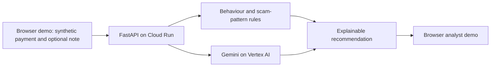

# ScamGuard — Last Mile Guard

**A second look before the money moves.** ScamGuard is a prototype for spotting scams in which a customer is persuaded to authorise a payment. It was built for the Google Cloud AI Builder Cup 2026, banking, financial services and insurance track.

The prototype uses made-up payments and customer stories. It does not connect to a bank, stop a real payment, or use real customer data. See [the pitch idea](docs/PITCH_IDEA.md) for the short product story.

## Problem and solution

An authorised payment can look legitimate to a bank even when a scammer has coached the customer into sending it. Transaction anomalies alone may miss the pressure, secrecy, or false story behind the payment.

ScamGuard checks a payment at that last step:

1. **Read the payment context.** Evaluate the amount, payee, device, timing, recent payments, and optional 15-day spending and payee history supplied with the request.
2. **Read the customer's words.** If a short note is supplied, Gemini produces a structured reading of scam signals and the customer's relationship with the payee. A local scam-pattern guide supplies relevant advice.
3. **Ask once when evidence is thin.** Gemini can write one or two neutral follow-up questions. The answer is assessed together with the first note.
4. **Recommend and explain.** Testable rules combine behavioural signals and message reading into **allow**, **warn**, or **hold for human review**. The response includes a score, ranked reasons, a customer warning where relevant, and an audit breakdown. The application only recommends an action; a bank would remain responsible for payment control and analyst review.

The web demo includes a live assessment console, a simulated analyst queue, a red-team run, an evidence page, and an architecture view. The analyst queue lives in browser state and is not a persistent bank case-management system.

## Architecture

### Implemented prototype



The browser sends one payment at a time to `POST /api/assess`. It sends the original note and question back with an answer for a second round; the API keeps no conversation database. `POST /api/arena` streams a live synthetic red-team run, and `GET /api/health` provides a health response. Cloud Run serves both the API and the built web app from one container.

### Recommended bank integration

The proposed next architecture connects a bank's payment event stream to **Pub/Sub**, obtains governed transaction and payee history from **BigQuery**, and calls the assessment service before the bank decides whether to release a payment. The bank's authenticated workflow would present warnings, route holds to an analyst, and retain the decision and audit record under its data-governance rules. This integration, persistent analyst queue, and production controls have **not** been implemented in this repository.

## Google technology and responsibilities

| Technology | Role in this project | Status |
| --- | --- | --- |
| **Gemini via Vertex AI** | Read a customer note and follow-up answer into a fixed schema; draft up to two short follow-up questions in one round. Rules make the final recommendation. | Implemented in the backend when `USE_VERTEX=1` and Google Cloud access is configured. |
| **Cloud Run** | Run the FastAPI service and serve the React build in one container, with instance and request limits. | Container and deployment script included. |
| **Cloud Build** | Build the container on Google Cloud from source for the Cloud Run deployment. | Used by the source-deploy workflow in `infra/deploy.sh`; no automatic GitHub CI pipeline is included. |
| **Google Cloud service account** | Let the Cloud Run service call Vertex AI using its runtime identity rather than a key file. | Supported by the client and deploy script; the account and permissions must be set up in the target project. |
| **Pub/Sub** | Carry payment events from a bank payment workflow to the assessment flow. | Proposed integration; not used by the prototype. |
| **BigQuery** | Supply governed transaction and payee history for behavioural checks and evaluation. | Proposed integration; the prototype receives history in each request instead. |

Local development can call Gemini with a `GEMINI_API_KEY` from an ignored `.env` file. The Cloud Run configuration uses Vertex AI and the service identity. The current scam-pattern guide is a versioned JSON file in `data/typologies.json`; there is no deployed search index or database in the assessment path.

## Tech stack

- **Web:** React, TypeScript, Vite, and Vitest in `web/`.
- **API:** Python, FastAPI, Pydantic, and Uvicorn in `backend/`.
- **AI:** Google Gen AI Python SDK for structured Gemini responses; Vertex AI in the Cloud Run configuration.
- **Risk engine:** Python rules for behavioural signals, corroboration, scoring, and explanations in `backend/risk/`.
- **Deployment:** Multi-stage Docker build and `gcloud run deploy --source` in `infra/deploy.sh`.
- **Evaluation:** Synthetic cases, Python evaluation scripts, red-team tools, Pytest, and web unit tests.

## Safety and current limits

- The demo uses synthetic data. The Gemini client blocks text that resembles an email address or payment-card number before sending it to the model.
- Customer text is treated as untrusted input. Model output is constrained to a schema; scoring and action thresholds remain in testable code.
- The API validates input size and fields, limits requests and Gemini calls, and falls back to payment-only rules if the model is unavailable or the call budget is exhausted.
- The analyst queue and its actions are a browser simulation. There is no persistent audit store, bank identity integration, or live payment hold mechanism.
- Results on synthetic and red-team cases are shown in the app's Evidence page. They do not establish performance on bank data or production readiness.

## Run locally

From the repository root, create an ignored `.env` from `.env.example` and set `GEMINI_API_KEY` if you want message reading. Then run the API and web development server in separate terminals:

```bash
python -m pip install -r backend/requirements.txt
python -m uvicorn backend.app:app --reload --port 8080
```

```bash
cd web
npm ci
npm run dev
```

Vite forwards `/api` requests to the local API on port 8080. Without Gemini credentials, the API can still return a payment-only recommendation when the model call fails.

Run the test suites with `python -m pytest backend/tests` and, from `web/`, `npm test`.

## Deploy the prototype

The provided script builds from source and deploys to Cloud Run:

```bash
PROJECT_ID=your-project-id bash infra/deploy.sh
```

Before running it, configure the Google Cloud project, required APIs, and the `lmg-runtime` service account with permission to call Vertex AI. Review the script's public access, region, resource caps, and cost settings for your environment. This deploys a **public synthetic-data demo**, not a bank production service.

## Repository layout

| Path | Contents |
| --- | --- |
| `backend/` | API, Gemini client, risk engine, and backend tests |
| `web/` | Active React demo and web tests |
| `data/` | Synthetic scenarios and the scam-pattern guide |
| `eval/` | Behaviour, message, flow, blind, and parity evaluations |
| `redteam/` | Synthetic attacker, customer, and reporting tools |
| `infra/` | Cloud Run deployment and result-export scripts |
| `docs/` | Pitch and design assets |

`frontend/` is a placeholder directory; the active interface is in `web/`.
