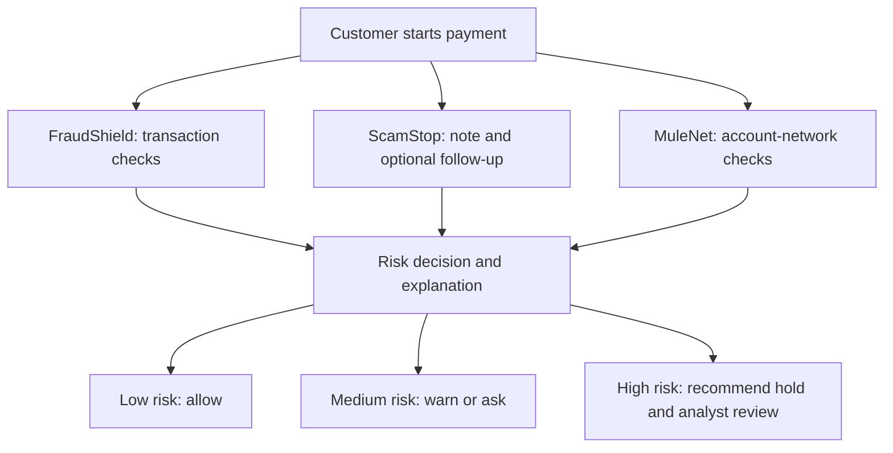

# FinGuard AI

- **Goal:** Investigate financial crime before a payment settles.
- **Solution:** Combine **FraudShield + ScamStop + MuleNet** in one risk decision and explanation flow.
- **Output:** Recommend **allow**, **warn/ask**, or **hold for human review**, with a score and reasons.
- **Stage:** Synthetic-data prototype for the Google Cloud AI Builder Cup 2026 BFSI track. No real bank or payment rail is connected.
- **Pitch:** [FinGuard AI idea](docs/PITCH_IDEA.md).

## What each part does

1. **FraudShield — transaction fraud:** Check amount, timing, device, payee, payment frequency, and recent payment history.
2. **ScamStop — customer manipulation:** Read the customer's note for pressure, secrecy, or coaching; ask one follow-up round when evidence is unclear.
3. **MuleNet — receiving-account risk:** Check account links, many recent senders, and rapid onward transfers.
4. **Risk decision and explanation:** Combine the available evidence, rank the reasons, and recommend an action. A bank would make the final payment-control decision.

## Agent and decision flow



- **Current implementation:** One FastAPI service. FraudShield and MuleNet use explainable rules; ScamStop uses Gemini for structured message reading and question writing. Rules choose the recommendation.
- **Target architecture:** A bank supplies trusted payment and account data, then controls warnings, holds, analyst review, and payment release. The diagram shows this intended decision flow; it does not imply a live bank integration.

## What works today

- **FraudShield:** Rule-based transaction and request-supplied history scoring in `backend/risk/behaviour.py`.
- **ScamStop:** Gemini-assisted note reading and one follow-up round; deterministic decision rules in `backend/risk/`.
- **MuleNet:** Rule-based checks on an optional, bounded **synthetic** transfer graph in `backend/risk/network.py`.
- **API:** `POST /api/assess` returns a recommendation, score, ranked reasons, and audit breakdown; `GET /api/health` checks service health.
- **Demo:** React assessment console, browser-only analyst queue, architecture and evidence views, and synthetic red-team arena.
- **Evaluation:** Synthetic scenarios, Python evaluations, red-team tools, Pytest, and web unit tests.

## Google technology

- **Gemini via Vertex AI — implemented when configured:** Extract structured scam signals from notes and answers; draft up to two neutral questions. Gemini does not approve or hold payments.
- **Cloud Run — deployment included:** Serve the FastAPI API and React build in one container.
- **Cloud Build — deployment included:** Build the container during `gcloud run deploy --source`.
- **Cloud service account — deployment supported:** Give Cloud Run access to Vertex AI without a key file in the service.
- **Pub/Sub — planned:** Receive authenticated payment events from a bank workflow.
- **BigQuery — planned:** Provide governed transaction, payee, and account-link history for scoring and evaluation.

## Tech stack

- **Web:** React, TypeScript, Vite, Vitest (`web/`).
- **API:** Python, FastAPI, Pydantic, Uvicorn (`backend/`).
- **AI:** Google Gen AI Python SDK and Gemini via Vertex AI (`backend/`).
- **Risk engine:** Explainable Python behaviour, scam, network, and decision rules (`backend/risk/`).
- **Deployment:** Docker and Cloud Run source deployment (`infra/`).

## Current limits

- The demo uses made-up payments, customer stories, and account links. The MuleNet graph arrives in the demo request; a production bank must source and bind it to the authenticated destination account.
- The analyst queue exists only in browser state. No persistent case store, bank identity integration, or live payment hold/release mechanism exists.
- The API returns audit details but does not persist them.
- Gemini can be unavailable; the API then falls back to transaction and network rules. Input limits and request/model-call limits protect the demo.
- Synthetic evaluation does not establish performance on real bank data.

## Next priorities

1. Bind each payment to trusted bank transaction and account-network data; replace request-supplied evidence in the production path.
2. Validate and calibrate combined scoring on held-back fraud, scam, mule, and legitimate cases.
3. Add authenticated analyst review, durable case/audit storage, and bank-controlled hold/release.
4. Add Pub/Sub ingestion, governed BigQuery lookups, monitoring, and automated CI checks.

## Run locally

1. Copy `.env.example` to an ignored `.env`; set `GEMINI_API_KEY` if you want Gemini message reading.
2. Start the API from the repository root:

   ```bash
   python -m pip install -r backend/requirements.txt
   python -m uvicorn backend.app:app --reload --port 8080
   ```

3. Start the web app in another terminal:

   ```bash
   cd web
   npm ci
   npm run dev
   ```

4. Run the tests: `python -m pytest backend/tests`; from `web/`, run `npm test`.

## Deploy the synthetic demo

- Configure the Google Cloud project, required APIs, and the `lmg-runtime` service account for Vertex AI.
- Run `PROJECT_ID=your-project-id bash infra/deploy.sh`.
- Review the script's public access, region, resource caps, and cost settings before deployment. This is a public synthetic-data demo, not a bank production system.
