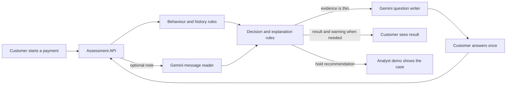
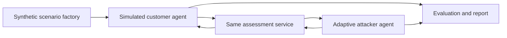

# ScamGuard — Last Mile Guard

**A second look before the money moves.** ScamGuard is a prototype for spotting scams in which a customer is persuaded to authorise a payment. It was built for the Google Cloud AI Builder Cup 2026, banking, financial services and insurance track.

The prototype uses made-up payments and customer stories. It does not connect to a bank, stop a real payment, or use real customer data. See [the pitch idea](docs/PITCH_IDEA.md) for the short product story.

**In one sentence:** before a customer sends money, we check the payment and their explanation for signs that someone is manipulating them, then recommend whether to proceed, warn them, or ask a human analyst to review it.

## Problem and solution

An authorised payment can look legitimate to a bank even when a scammer has coached the customer into sending it. Transaction anomalies alone may miss the pressure, secrecy, or false story behind the payment.

For example, a customer may be about to transfer money to a new account after a caller claiming to be from the bank tells them to act immediately. The payment is authorised by the customer, but the note, new payee, unusual timing, and live call together give the bank a reason to pause and ask more. ScamGuard aims to catch that situation before the transfer is released while letting ordinary payments through.

ScamGuard checks a payment at that last step:

1. **Read the payment context.** Evaluate the amount, payee, device, timing, recent payments, and optional 15-day spending and payee history supplied with the request.
2. **Read the customer's words.** If a short note is supplied, Gemini produces a structured reading of scam signals and the customer's relationship with the payee. A local scam-pattern guide supplies relevant advice. Links in the note are checked as text only: shortened links, look-alike addresses and payment-request links add risk points. A link is never opened or fetched.
3. **Ask once when evidence is thin.** Gemini can write one or two neutral follow-up questions. The answer is assessed together with the first note.
4. **Recommend and explain.** Testable rules combine behavioural signals and message reading into **allow**, **warn**, or **hold for human review**. The response includes a score, ranked reasons, a customer warning where relevant, and an audit breakdown. The application only recommends an action; a bank would remain responsible for payment control and analyst review.

The web demo includes a live assessment console (try one case, watch the red team, or describe your own scenario), a simulated analyst queue, an evidence page, and an architecture view. A customer's warning can be shown in Hindi, Spanish, French, Portuguese or Arabic. The analyst queue lives in browser state and is not a persistent bank case-management system.

## Assessment and agent flow

The payment assessment is **one service with two Gemini-assisted tasks**, not a set of agents voting on a payment. The **message reader** extracts structured facts from the customer's note or answer. The **question writer** produces one or two short questions only when the rules say more context is needed. Deterministic behaviour and decision rules combine the evidence and choose the recommendation; Gemini does not directly approve or hold a payment.



The browser sends one payment at a time to `POST /api/assess`. If the service asks questions, the browser sends the original note, questions, and answer back for a second assessment. The API keeps no conversation database. A real bank would make the actual payment and hold decisions; the current analyst screen only simulates that review.

### Agents used to test the guard

These agents are **test actors**, not part of a customer's payment decision. The scenario factory builds made-up scam and genuine cases. A simulated customer agent writes the note and, when asked, an answer. A separate adaptive attacker agent tries alternative scam wording against the deployed demo. The evaluator compares the guard's responses with the hidden scenario labels and reports missed scams and false alarms. The guard does not receive those labels.



The website's live arena (`backend/arena.py`) plays scam cases modelled on public advice pages, plus genuine and trick cases from the scenario factory, using the simulated customer agent. A visitor can also describe their own scenario (`POST /api/custom`), which the same agent plays. The adaptive attacker in `redteam/attacker.py` is run separately by the red-team tools; it is not a live production agent.

## Testing against public fraud patterns

The scam cases in the live arena and the evaluation are modelled on fraud patterns described on public advice pages: the US Federal Trade Commission's consumer alerts and Australia's Scamwatch (ACCC). A careful reader (`redteam/intel/reports.py`) contacts only those named sites over https, follows each site's `robots.txt`, refuses redirects off the list, paces itself, and stops at a hard limit. It runs in Cloud Shell only and never saves page text. Gemini then writes an invented customer for each pattern, with made-up names and amounts, and each case records the page it was modelled on. The site shows that source and a link. UK Action Fraud is not used because its `robots.txt` asks automated readers to stay away. Scamwatch content is used under its Creative Commons Attribution licence.

Half of those cases are held back in a locked test set and run once. The results, including the weak ones and the faults we found and fixed in our own test data and in the message reader, are on the Evidence page. They are small samples and do not establish performance on bank data.

## Google Cloud architecture

### Implemented prototype

The React browser demo calls the FastAPI service on Cloud Run. The service applies local rules and calls Gemini through Vertex AI for the two text tasks shown above. Cloud Run serves both the API and built web app from one container. `POST /api/arena` streams a live synthetic red-team run, and `GET /api/health` provides a health response. Cloud Build builds the container during source deployment.

### Recommended bank integration

The proposed next architecture connects a bank's payment event stream to **Pub/Sub**, obtains governed transaction and payee history from **BigQuery**, and calls the assessment service before the bank decides whether to release a payment. The bank's authenticated workflow would present warnings, route holds to an analyst, and retain the decision and audit record under its data-governance rules. This integration, persistent analyst queue, and production controls have **not** been implemented in this repository.

## Google technology and responsibilities

| Technology | Role in this project | Status |
| --- | --- | --- |
| **Gemini via Vertex AI** | Read a customer note and follow-up answer into a fixed schema; draft up to two short follow-up questions in one round. Rules make the final recommendation. | Implemented in the backend when `USE_VERTEX=1` and Google Cloud access is configured. |
| **Cloud Run** | Run the FastAPI service and serve the React build in one container, with instance and request limits. | Container and deployment script included. |
| **Cloud Build** | Build the container on Google Cloud from source for the Cloud Run deployment. | Used by the source-deploy workflow in `infra/deploy.sh`; no automatic GitHub CI pipeline is included. |
| **Google Cloud service account** | Let the Cloud Run service call Vertex AI using its runtime identity rather than a key file. | Supported by the client and deploy script; the account and permissions must be set up in the target project. |
| **Cloud Text-to-Speech** | Narrate the explainer video (`video/`), a synthetic voice generated in Cloud Shell. | Used for the video only, not in the payment path. |
| **Pub/Sub** | Carry payment events from a bank payment workflow to the assessment flow. | Proposed integration; not used by the prototype. |
| **BigQuery** | Supply governed transaction and payee history for behavioural checks and evaluation. | Proposed integration; the prototype receives history in each request instead. |

Local development can call Gemini with a `GEMINI_API_KEY` from an ignored `.env` file. The Cloud Run configuration uses Vertex AI and the service identity. The current scam-pattern guide is a versioned JSON file in `data/typologies.json`; there is no deployed search index or database in the assessment path.

## Tech stack

- **Web:** React, TypeScript, Vite, and Vitest in `web/`.
- **API:** Python, FastAPI, Pydantic, and Uvicorn in `backend/`.
- **AI:** Google Gen AI Python SDK for structured Gemini responses; Vertex AI in the Cloud Run configuration.
- **Risk engine:** Python rules for behavioural signals, corroboration, scoring, and explanations in `backend/risk/`.
- **Deployment:** Multi-stage Docker build and `gcloud run deploy --source` in `infra/deploy.sh`.
- **Evaluation:** Synthetic cases, Python evaluation scripts, red-team tools, Pytest, and web unit tests.

## Safety and current limits

- The demo uses synthetic data. The Gemini client blocks text that resembles an email address or payment-card number before sending it to the model.
- Customer text is treated as untrusted input. Model output is constrained to a schema; scoring and action thresholds remain in testable code.
- The API validates input size and fields, limits requests and Gemini calls, and falls back to payment-only rules if the model is unavailable or the call budget is exhausted.
- A visitor's own scenario has its own limits (one a minute and a few an hour for each visitor), checks input ranges and lengths in the browser and on the server, refuses email addresses and card numbers, and never logs or returns the story text.
- The link check reads link text only. Translation is applied to the warning our rules wrote, never to the customer's words, and never changes the decision; the English warning stays as the record.
- The analyst queue and its actions are a browser simulation. There is no persistent audit store, bank identity integration, or live payment hold mechanism.
- Results on synthetic and red-team cases are shown in the app's Evidence page. They do not establish performance on bank data or production readiness.

## Run locally

From the repository root, create an ignored `.env` from `.env.example` and set `GEMINI_API_KEY` if you want message reading. Then run the API and web development server in separate terminals:

```bash
python -m pip install -r backend/requirements.txt
python -m uvicorn backend.app:app --reload --port 8080
```

```bash
cd web
npm ci
npm run dev
```

Vite forwards `/api` requests to the local API on port 8080. Without Gemini credentials, the API can still return a payment-only recommendation when the model call fails.

Run the test suites with `python -m pytest backend/tests` and, from `web/`, `npm test`. Our own team runs installs, cloud commands and server tests in Cloud Shell, not on laptops.

## Deploy the prototype

The provided script builds from source and deploys to Cloud Run:

```bash
PROJECT_ID=your-project-id bash infra/deploy.sh
```

Before running it, configure the Google Cloud project, required APIs, and the `lmg-runtime` service account with permission to call Vertex AI. Review the script's public access, region, resource caps, and cost settings for your environment. This deploys a **public synthetic-data demo**, not a bank production service.

## Repository layout

| Path | Contents |
| --- | --- |
| `backend/` | API, Gemini client, risk engine, and backend tests |
| `web/` | Active React demo and web tests |
| `data/` | Synthetic scenarios and the scam-pattern guide |
| `eval/` | Behaviour, message, flow, blind, and parity evaluations |
| `redteam/` | Synthetic attacker, customer, and reporting tools |
| `infra/` | Cloud Run deployment and result-export scripts (`save_results.sh` checks files for secrets before saving) |
| `docs/` | Pitch and design assets |
| `video/` | The explainer video: narration, a Text-to-Speech script and animated scenes, built in Cloud Shell |

`frontend/` is a placeholder directory; the active interface is in `web/`.
