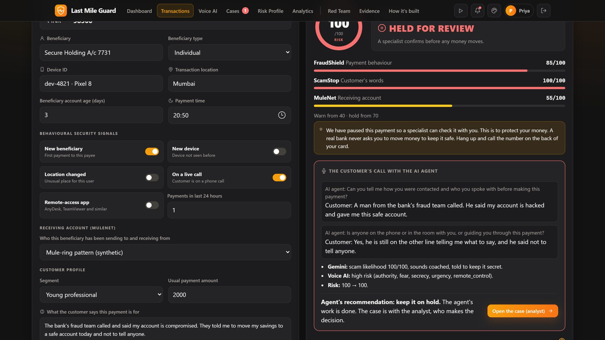
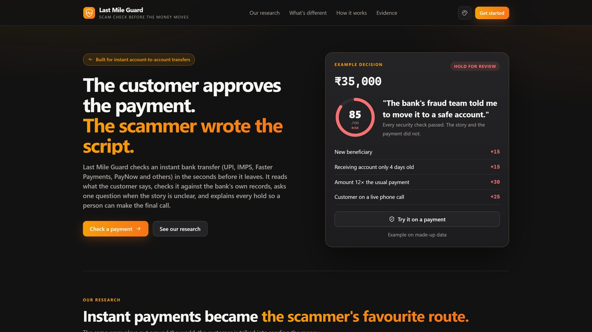
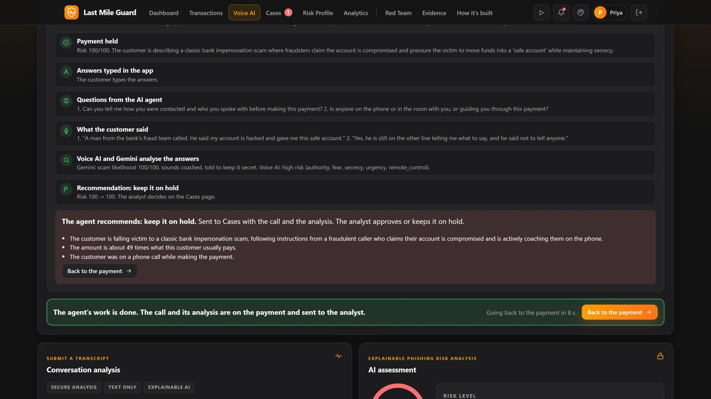
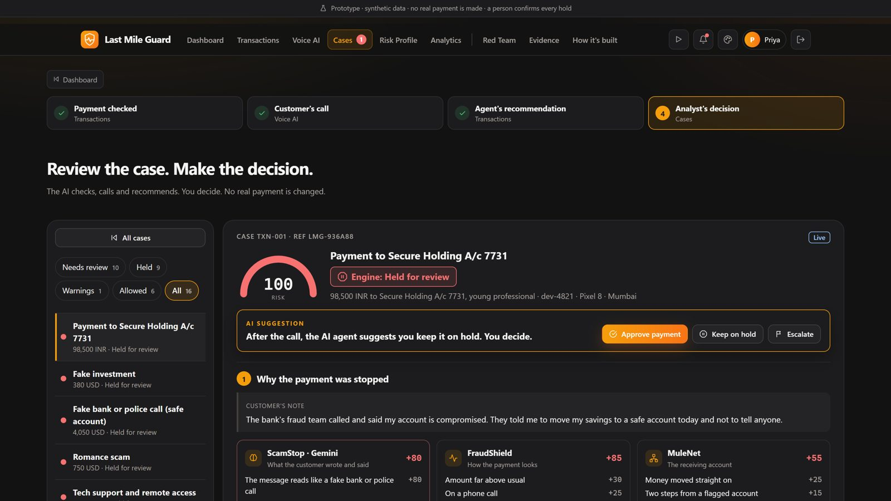
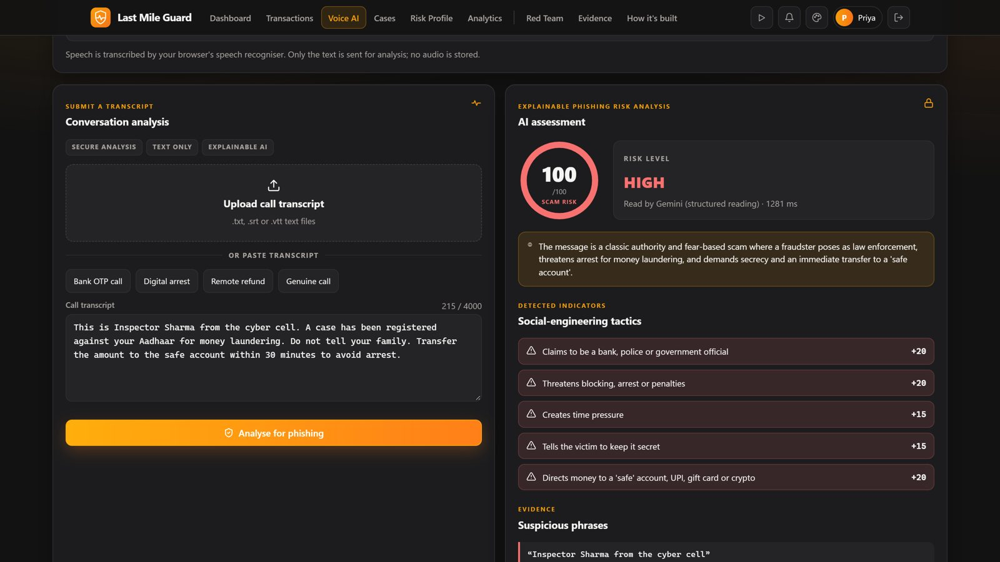
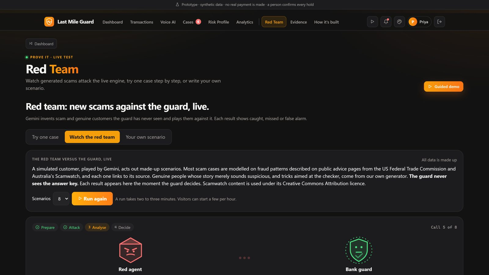
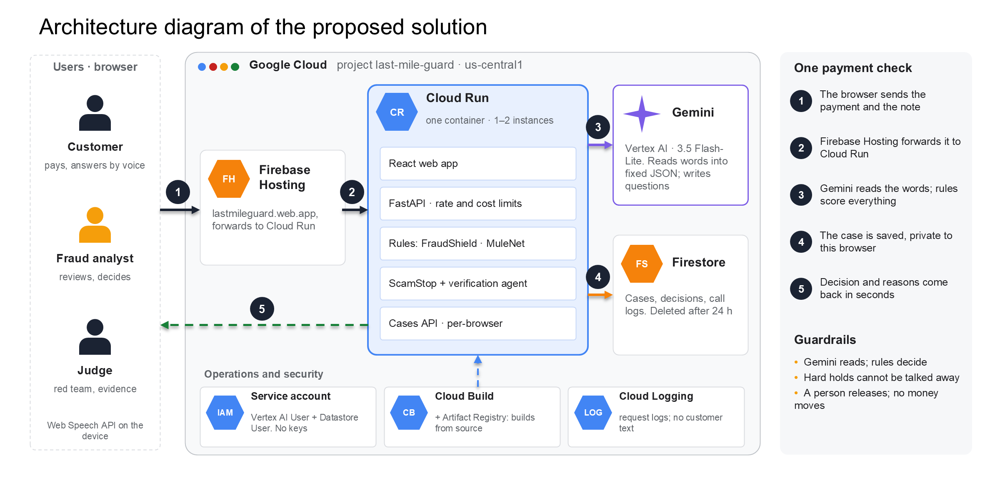
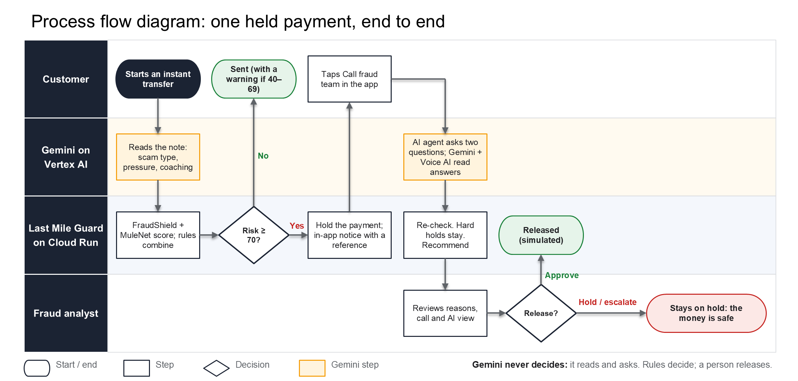
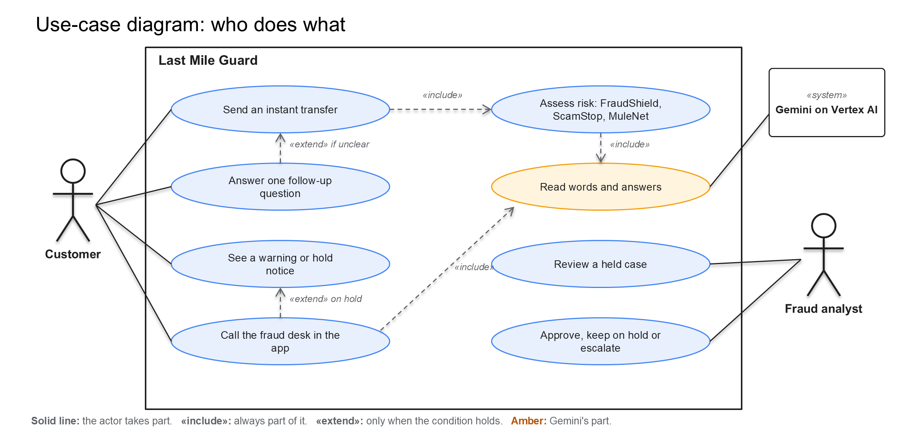

# Last Mile Guard

**A second look before the money moves.** Last Mile Guard stops scams where a coached customer approves the payment themselves. It checks the payment, reads the customer's own words with Gemini, checks the receiving account, calls the customer inside the banking app when a payment is held, and gives a fraud analyst everything needed to decide.

Built for the **Google Cloud AI Builder Cup JAPAC 2026**, BFSI track (Intelligent Risk, Fraud & Financial Experiences).

| | |
| --- | --- |
| **Live app** | **https://lastmileguard.web.app** (Firebase Hosting → Cloud Run) |
| Same service on Cloud Run | https://last-mile-guard-lcjgzaksea-uc.a.run.app |
| Source code | https://github.com/05lakb/scamguard |
| Stage | Working prototype with synthetic data. No bank, payment rail or real money is connected. |



---

## Contents

1. [The problem](#the-problem)
2. [What Last Mile Guard does](#what-last-mile-guard-does)
3. [Try it on the live site (2 minutes)](#try-it-on-the-live-site-2-minutes)
4. [Screenshots](#screenshots)
5. [Architecture and Google Cloud](#architecture-and-google-cloud)
6. [Tech stack](#tech-stack)
7. [Run it locally, step by step](#run-it-locally-step-by-step)
8. [Deploy to Google Cloud](#deploy-to-google-cloud)
9. [API](#api)
10. [Evaluation](#evaluation)
11. [Safety and limits](#safety-and-limits)
12. [Repository layout](#repository-layout)

---

## The problem

In an authorised push-payment scam the victim sends the money from their own phone. A fake bank officer, police caller or "investment adviser" tells them what to do and what to say. Every security check passes, so the bank sees a normal payment, and instant transfers settle in seconds.

| Figure | What it is | Source |
| --- | --- | --- |
| **$442 bn** | lost to scams in a year across 42 countries | GASA & Feedzai, 2025 |
| **$16 bn** | US fraud losses reported in 2025, a record | US FTC, 2026 |
| **₹22,845 crore** | lost by Indian citizens to cyber criminals in 2024 | Ministry of Home Affairs, reply to the Lok Sabha, 2025 |

## What Last Mile Guard does

| Step | What happens | Who decides |
| --- | --- | --- |
| 1. Check the payment | **FraudShield** scores the payment against the customer's usual behaviour (amount, new payee, device, location, live call, remote-access app, 15-day history). **MuleNet** checks the receiving account (links to flagged accounts, many senders, money moved straight on). | Plain, testable rules |
| 2. Read the words | **ScamStop** sends the customer's note to **Gemini**, which returns a fixed form: scam type, pressure, secrecy, coaching, claimed history. When the evidence is thin it writes one neutral follow-up question. | Gemini reads; rules score |
| 3. Decide | The scores are combined: **allow** below 40, **warn** from 40, **hold** from 70. Every point has a written reason. | Rules |
| 4. Call in the app | On a hold the customer gets an in-app notice with a reference and taps **Call fraud team**. An AI agent speaks two questions; Gemini and Voice AI read the answers and recommend. | AI recommends only |
| 5. A person decides | The analyst sees the reasons, the call and the AI's view on **Cases**, then approves, keeps on hold or escalates. Every decision is saved with name and time. | **The analyst** |

Some holds cannot be talked away: a remote-control app, a receiving account linked to a flagged one, or hidden orders in the note keep the payment on hold for a person whatever the customer says. If Gemini is unavailable the rules still decide, and a hold is never released.

## Try it on the live site (2 minutes)

1. Open **https://lastmileguard.web.app**, press **Get started** and type any name (there are no accounts or passwords).
2. **Transactions:** pick **Bank-impersonation call** and press **Analyse transaction**. The payment is held at risk 100, with the three engine scores and ranked reasons.
3. In the notice that appears, press **Call fraud team**. Allow the microphone and answer the AI agent's two questions, or type the answers.
4. You are brought back to the payment with the agent's recommendation. Press **Open the case (analyst)**.
5. **Cases:** read why the payment was stopped and what the customer said, then **Approve**, **Keep on hold** or **Escalate**. The case shows what that decision means.

Also worth a look: **Voice AI** (score a call transcript), **Red Team** (Gemini plays new scams and genuine customers against the guard, live), **Evidence** (measured results, misses included) and **How it's built**.

## Screenshots

| | |
| --- | --- |
|  <br> Landing: the problem and the research |  <br> Transactions: held, with the AI agent's call |
|  <br> Voice AI: the in-app call with the AI agent |  <br> Cases: the analyst's review and decision |
|  <br> Voice AI: a "digital arrest" call scored |  <br> Red Team: Gemini attacks the guard live |

## Architecture and Google Cloud



| Google Cloud service | How Last Mile Guard uses it |
| --- | --- |
| **Gemini on Vertex AI** (`gemini-3.5-flash-lite`) | Reads the customer's note and call answers into a fixed JSON schema, writes the follow-up and call questions, scores call transcripts, translates warnings, and plays the red team. It never approves or holds a payment. |
| **Cloud Run** | One container serves the FastAPI API and the React app. One warm instance during judging, at most two. |
| **Firestore** | Stores cases, analyst decisions, call results and notes. Each browser only sees its own cases, and every document is deleted after 24 hours (TTL). |
| **Firebase Hosting** | The public address `lastmileguard.web.app`, forwarding every request to Cloud Run. |
| **Cloud Build + Artifact Registry** | Build the container from source on each deploy. |
| **IAM service account** | Cloud Run runs as `lmg-runtime` with two roles: Vertex AI User and Cloud Datastore User. No API keys or key files. |
| **Cloud Logging** | Request logs only; customer text is not logged. |

**Process flow (one held payment, end to end):**



**Use cases (who does what):**



## Tech stack

| Layer | Technology | Where |
| --- | --- | --- |
| AI | Gemini 3.5 Flash-Lite on Vertex AI, Google Gen AI Python SDK | `backend/gemini_client.py` |
| Risk engine | Python rules: FraudShield (behaviour), MuleNet (account network), ScamStop (message evidence), decision layer | `backend/risk/` |
| AI agent call | Verification agent: Gemini-written question, safety question, re-check | `backend/verification.py` |
| API | Python 3.12+, FastAPI, Pydantic, Uvicorn | `backend/app.py` |
| Storage | Firestore (in the cloud) or in-memory (local) | `backend/store.py` |
| Web app | React 19, TypeScript, Vite | `web/` |
| Voice | Web Speech API in the browser (speech to text and text to speech) | `web/src/lib/speech.ts` |
| Hosting | Firebase Hosting → Cloud Run, Docker multi-stage build | `firebase.json`, `Dockerfile`, `infra/deploy.sh` |
| Tests | pytest (286 backend tests), Vitest (303 web tests) | `backend/tests/`, `web/src/**/*.test.ts` |
| Evaluation | Synthetic scenarios, blind test, paired rules-vs-Gemini run, red-team generator | `data/`, `eval/`, `redteam/` |

## Run it locally, step by step

### Prerequisites

| Tool | Version | Check with |
| --- | --- | --- |
| Git | any | `git --version` |
| Python | 3.12 or newer | `python --version` |
| Node.js | 20 or newer (LTS) | `node --version` |
| Gemini API key | optional, from [Google AI Studio](https://aistudio.google.com/apikey) | – |

Without a Gemini key the app still runs end to end: message reading and Voice AI use transparent phrase rules instead, and the screen says so.

### 1. Get the code

```bash
git clone https://github.com/05lakb/scamguard.git
cd scamguard
```

Run every command below from this folder (the one that contains `backend/` and `web/`) unless a step says `cd web`.

### 2. Install the backend

**Windows (PowerShell)**

```powershell
python -m venv .venv
.\.venv\Scripts\Activate.ps1
python -m pip install -r backend\requirements.txt
```

**macOS / Linux**

```bash
python3 -m venv .venv
source .venv/bin/activate
python -m pip install -r backend/requirements.txt
```

### 3. Settings

Copy the example settings file:

```bash
cp .env.example .env          # Windows PowerShell: Copy-Item .env.example .env
```

`.env` already contains `LMG_STORE=memory`, which keeps cases and analyst decisions in memory while the API runs. To use Gemini, paste your key after `GEMINI_API_KEY=`. Never commit `.env` (git ignores it).

### 4. Install the web app

```bash
cd web
npm ci                        # Windows PowerShell: npm.cmd ci
cd ..
```

### 5. Start it (two terminals)

**Terminal 1, the API on http://localhost:8080** (activate the virtual environment first, as in step 2):

```bash
python -m uvicorn backend.app:app --reload --port 8080
```

**Terminal 2, the website on http://localhost:5173:**

```bash
cd web
npm run dev                   # Windows PowerShell: npm.cmd run dev
```

Open **http://localhost:5173**. The website forwards `/api` calls to the API on port 8080. Check the API on its own at http://localhost:8080/api/health; it returns `{"ok": true, "ai_configured": ..., "storage": "memory"}`.

Then follow [Try it](#try-it-on-the-live-site-2-minutes) from step 1.

### Or: one server, like production

Build the web app once; the API then serves it on the same port:

```bash
cd web && npm run build && cd ..          # Windows: cd web; npm.cmd run build; cd ..
python -m uvicorn backend.app:app --port 8080
```

Open **http://localhost:8080**.

### 6. Run the tests

| Check | Command | Expected |
| --- | --- | --- |
| Backend | `python -m pytest backend/tests -q` | 286 passed |
| Web type check and build | `cd web` then `npm run build` | build completes with no errors |
| Web unit tests | `cd web` then `npm test` | 303 passed |

No test calls the internet or Gemini; the backend tests use fake readers.

### Troubleshooting

| Problem | Fix |
| --- | --- |
| PowerShell: `running scripts is disabled` for `npm` or `Activate.ps1` | Use `npm.cmd` instead of `npm`. For the virtual environment run `Set-ExecutionPolicy -Scope Process Bypass` in that window, or call `.venv\Scripts\python.exe` directly. |
| `No module named fastapi` / `pytest` | The virtual environment is not active. Activate it (step 2) or re-run the `pip install`. |
| Website says **API offline** | Start terminal 1 (port 8080) and refresh. |
| Cases page stays empty after a refresh | Make sure `.env` contains `LMG_STORE=memory`, then restart the API. |
| Voice AI says **phrase rules only** | Expected without a key. Add `GEMINI_API_KEY` to `.env` and restart the API. |
| Microphone does not work | Use Chrome or Edge and allow the microphone, or type the answers instead. |
| `npm ci` fails with `EPERM` | Stop `npm run dev` and close editors that have `web/` open, then run it again. |

## Deploy to Google Cloud

From Google Cloud Shell, in the repository folder:

```bash
# Cloud Run with Gemini on Vertex AI and Firestore case storage
PROJECT_ID=your-project-id FIRESTORE=1 MIN_INSTANCES=1 bash infra/deploy.sh

# Firebase Hosting in front of Cloud Run (firebase.json and .firebaserc are in the repo)
firebase deploy --only hosting
```

The script needs the Vertex AI, Cloud Run, Cloud Build and Firestore APIs enabled, a Firestore database in `us-central1`, and a service account `lmg-runtime` with the Vertex AI User and Cloud Datastore User roles. It sets one warm instance (at most two), 1 CPU and 512 MiB, and uses no API keys. Set `MIN_INSTANCES=0` after judging to stop idle charges.

## API

| Method and path | What it does |
| --- | --- |
| `GET /api/health` | Service status, whether Gemini is configured, and which case store is active |
| `POST /api/assess` | Assess one payment: action, score, ranked reasons and audit breakdown |
| `POST /api/assess/stream` | The same assessment, streamed stage by stage |
| `POST /api/conversation` | Score a call transcript (Voice AI) |
| `GET /api/cases`, `GET /api/cases/{id}` | This browser's cases |
| `POST /api/cases/{id}/decision` | Save the analyst's decision |
| `POST /api/cases/{id}/notes` | Add an analyst note |
| `POST /api/cases/{id}/verification`, `.../verification/answers` | Start the AI agent call and send the customer's answers |
| `POST /api/callback-brief` | Prepare the analyst's call-back questions |
| `POST /api/arena`, `POST /api/custom` | Red team: generated scenarios, or the visitor's own scenario |

Cases belong to the browser that created them (a random session key sent in the `X-LMG-Session` header). Input sizes, request rates and Gemini calls are capped.

## Evaluation

All numbers are on synthetic data and are shown, with the raw files, on the app's **Evidence** page.

| Test | Scams flagged | Genuine customers stopped |
| --- | --- | --- |
| Payment rules alone, 200 cases we built | 70% | 20% |
| Full system, blind test of 50 cases written by someone else | 84% | 12% |
| Full system, 4 fresh runs of 40 cases with a Gemini-played customer | 85% to 92% | 0% to 14% |

- Latest blind run: **38 of 40** behaved as expected. Coached victims are the hardest case: 3 of 5 caught.
- Paired run of 50 cases, rules versus rules + Gemini: median **7.1 s** for a fresh Gemini reading (95th percentile 16.8 s), **0** API errors or fallbacks.
- Method and reproduction: [docs/PAIRED_EVALUATION.md](docs/PAIRED_EVALUATION.md); recorded results: [docs/EVALUATION_RESULTS.md](docs/EVALUATION_RESULTS.md).

Small synthetic samples show direction, not a bank-grade rate.

## Safety and limits

- **Gemini reads, rules decide, a person releases.** Model output is constrained to a schema; thresholds and actions live in tested code.
- Customer text is treated as untrusted. Emails and card numbers are blocked before anything is sent to the model. Links are read as text and never opened.
- Cases are private to the browser that created them and deleted after 24 hours.
- No real bank data, payment rail or money. The receiving-account network comes with the demo request; a bank would supply it from its own records.
- A phone-call path through Twilio is built and signature-checked but switched off; the in-app call is used instead.
- A calm, well-coached victim paying something ordinary can still get through.

## Repository layout

| Path | Contents |
| --- | --- |
| `backend/` | FastAPI app, Gemini client, risk engine (`risk/`), verification agent, case store, tests |
| `web/` | React + TypeScript web app and its tests |
| `data/` | Synthetic scenarios, scam-pattern guide and blind-test cases |
| `eval/` | Evaluation runners and evidence exporters |
| `redteam/` | Red-team generator, simulated customer and public-advice pattern tools |
| `infra/` | Cloud Run deploy script and helper scripts |
| `hosting/` | Firebase Hosting public folder (empty; Hosting forwards to Cloud Run) |
| `docs/` | Architecture diagrams, screenshots, evaluation notes, branding, demo video |
| `video/` | Source of the explainer video (Remotion scenes, narration script) |
