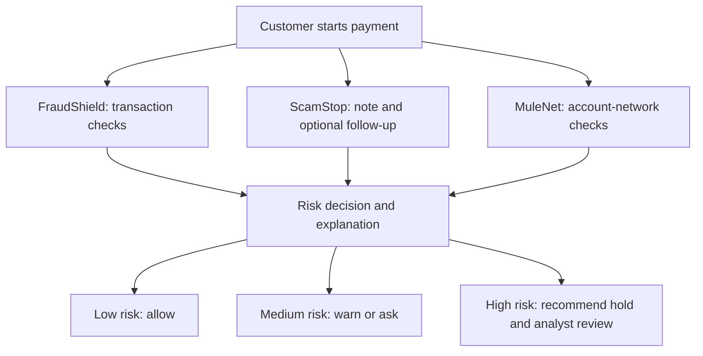

# Last Mile Guard

**Real-time protection for account-to-account transfers (UPI, IMPS, NEFT) before money moves.** Last Mile Guard checks a payment's behaviour, the customer's own words or call transcript, and the receiving account's network, then recommends **allow**, **warn/ask** or **hold for human review** with ranked, explainable reasons.

- **Stage:** synthetic-data prototype. No real bank or payment rail is connected; no money is ever moved.
- **Pitch:** [idea](docs/PITCH_IDEA.md)

## The command centre

| Page | What it does | Backend |
| --- | --- | --- |
| Landing | The problem (authorised account-to-account scams), features, how it works, why it matters, **Get started** | – |
| Dashboard | Security overview, risk distribution, actions, top signals, the fraud intelligence suite, and the detection engines (FraudShield, ScamStop, MuleNet, decision layer) with live API/Gemini status | `GET /api/health` |
| Transactions | Analyse one account-to-account transfer and see the whole investigation on one page: overall score, a score bar per engine, ranked reasons, the analyst decision (approve / hold / escalate) with audit trail, customer, device and location context, and the receiving-account network drawn by MuleNet (this payment shown going into the beneficiary) | `POST /api/assess` |
| Voice AI | Live call detection (browser speech recognition), transcript upload (.txt/.srt/.vtt) or paste; scam-risk score, tactics, suspicious phrases, recommended action | `POST /api/conversation` |
| Cases | Review queue for every warning and hold, with **Run test scenario** against the real backend | `POST /api/assess` |
| Risk Profile | One customer's overall risk score with reasons, devices, beneficiaries, locations, transaction history (filter by decision) and fraud alerts | session cases |
| Analytics | KPIs, risk distribution, decisions, top signals, analyst feedback, risk by location, recent assessments across all transactions | session cases |
| Scenario Lab | Scenario library with live streamed checks, a five-step guided demo and the red-team arena | `POST /api/assess/stream`, `POST /api/arena` |
| Evidence, Architecture | Evaluation results and how the system fits together (footer links) | – |

Sign-in asks only for a display name (kept in this browser); there are no accounts or passwords.

## What each part does

1. **FraudShield — transaction fraud:** Check amount, timing, device, location change, payee, payment frequency, and recent payment history.
2. **ScamStop — customer manipulation:** Read the customer's note for pressure, secrecy, or coaching; ask one follow-up round when evidence is unclear.
3. **MuleNet — receiving-account risk:** Check account links, many recent senders, and rapid onward transfers.
4. **Risk decision and explanation:** Combine the available evidence, rank the reasons, and recommend an action. A bank would make the final payment-control decision.

## Agent and decision flow



- **Current implementation:** One FastAPI service. FraudShield and MuleNet use explainable rules; ScamStop uses Gemini for structured message reading and question writing. Rules choose the recommendation.
- **Target architecture:** A bank supplies trusted payment and account data, then controls warnings, holds, analyst review, and payment release. The diagram shows this intended decision flow; it does not imply a live bank integration.

## What works today

- **FraudShield:** Rule-based transaction and request-supplied history scoring in `backend/risk/behaviour.py`.
- **ScamStop:** Gemini-assisted note reading and one follow-up round; deterministic decision rules in `backend/risk/`.
- **MuleNet:** Rule-based checks on an optional, bounded **synthetic** transfer graph in `backend/risk/network.py`.
- **Voice AI:** `backend/risk/conversation.py` scores a call transcript with Gemini when configured, or with transparent phrase rules (OTP/PIN requests, impersonation, threats, urgency, secrecy, remote-access apps, off-platform payment) when it is not. The response always says which reader ran.
- **API:** `POST /api/assess` returns a recommendation, score, ranked reasons, audit breakdown and execution provenance; `POST /api/assess/stream` streams each pipeline stage live; `POST /api/conversation` scores a transcript; `GET /api/health` reports service health and whether AI reading is configured.
- **Demo:** React command centre with seven tabs (Dashboard, Transactions, Voice AI, Cases, Risk Profile, Analytics, Scenario Lab), a full per-transaction investigation (case file, three-engine evidence, customer conversation, context and MuleNet graph), analyst queue with **Run test scenario** calling the real backend, guided demo, red-team arena, Evidence and Architecture pages, and four colour themes.
- **Evaluation:** Synthetic scenarios, Python evaluations, red-team tools, Pytest, and web unit tests.

## Google technology

- **Gemini via Vertex AI — implemented when configured:** Extract structured scam signals from notes and answers; draft up to two neutral questions. Gemini does not approve or hold payments.
- **Cloud Run — deployment included:** Serve the FastAPI API and React build in one container.
- **Cloud Build — deployment included:** Build the container during `gcloud run deploy --source`.
- **Cloud service account — deployment supported:** Give Cloud Run access to Vertex AI without a key file in the service.
- **Pub/Sub — planned:** Receive authenticated payment events from a bank workflow.
- **BigQuery — planned:** Provide governed transaction, payee, and account-link history for scoring and evaluation.

## Tech stack

- **Web:** React, TypeScript, Vite, Vitest (`web/`).
- **API:** Python, FastAPI, Pydantic, Uvicorn (`backend/`).
- **AI:** Google Gen AI Python SDK and Gemini via Vertex AI (`backend/`).
- **Risk engine:** Explainable Python behaviour, scam, network, and decision rules (`backend/risk/`).
- **Deployment:** Docker and Cloud Run source deployment (`infra/`).

## Current limits

- The demo uses made-up payments, customer stories, and account links. The MuleNet graph arrives in the demo request; a production bank must source and bind it to the authenticated destination account.
- The analyst queue exists only in browser state. No persistent case store, bank identity integration, or live payment hold/release mechanism exists.
- The API returns audit details but does not persist them.
- Gemini can be unavailable; the API then falls back to transaction and network rules. Input limits and request/model-call limits protect the demo.
- Synthetic evaluation does not establish performance on real bank data.

## Next priorities

1. Bind each payment to trusted bank transaction and account-network data; replace request-supplied evidence in the production path.
2. Validate and calibrate combined scoring on held-back fraud, scam, mule, and legitimate cases.
3. Add authenticated analyst review, durable case/audit storage, and bank-controlled hold/release.
4. Add Pub/Sub ingestion, governed BigQuery lookups, monitoring, and automated CI checks.

## Live backend-verified analyst demonstration

For an exact local test walkthrough, synthetic scenario selection, Gemini cache/fallback labels, and an independent PowerShell API test, see [Analyst backend demo](docs/ANALYST_DEMO.md). The backend returns a request ID and timing for every payment assessment, which the application displays next to the scored evidence.

## Run and test locally

You need **Python 3.12+** and **Node.js 20+ (LTS)**. A Gemini key is optional: without one, message reading and Voice AI fall back to transparent rules and the screen says so.

Run every command from the repository root (the folder that contains `backend/` and `web/`), unless a step says `cd web`.

### 1. Install

**Windows (PowerShell)**

```powershell
python -m pip install -r backend\requirements.txt
cd web
npm.cmd ci
cd ..
```

PowerShell blocks `npm` by default; `npm.cmd` runs the same tool without changing security settings.

**macOS / Linux**

```bash
python3 -m pip install -r backend/requirements.txt
cd web && npm ci && cd ..
```

Optional: copy `.env.example` to `.env` and set `GEMINI_API_KEY` to enable Gemini reading. Never commit `.env`.

### 2. Run the automated tests

| Check | Windows | macOS / Linux | Expected |
| --- | --- | --- | --- |
| Backend | `python -m pytest backend\tests` | `python3 -m pytest backend/tests` | all tests pass (211 at the time of writing) |
| Web build (type check + bundle) | `cd web; npm.cmd run build` | `cd web && npm run build` | build completes with no errors |
| Web unit tests | `cd web; npm.cmd test` | `cd web && npm test` | all Vitest suites pass |

No test calls the internet or Gemini; the backend tests use fake readers.

### 3. Start the app

Use two terminals, both starting at the repository root.

```bash
# Terminal 1 - API on http://localhost:8080
python -m uvicorn backend.app:app --reload --port 8080
```

```bash
# Terminal 2 - website on http://localhost:5173
cd web
npm run dev        # Windows PowerShell: npm.cmd run dev
```

Open http://localhost:5173. The website forwards `/api` calls to the API automatically.

### 4. Try it in five minutes

1. Press **Get started** and enter any name (there are no accounts; the name only personalises the workspace).
2. **Transactions:** choose *Bank-impersonation call* and press **Analyse transaction**. Expect a hold, a high risk score and ranked reasons. Scroll down to see the whole investigation for that payment on the same page: the analyst decision (approve, hold or escalate), customer, device and location context, and the receiving-account network scored by MuleNet.
3. Choose *Everyday payment* and analyse again. Expect *allow* with no risk signals.
4. **Voice AI:** choose *Bank OTP call* and press **Analyse for phishing**. Expect high risk, the tactics found and the suspicious sentences. Live microphone detection works in Chrome and Edge.
5. **Cases:** every warning and hold from step 2 is waiting here. Open one and record a decision, or use **Run test scenario** to send a library scenario to the backend.
6. **Risk Profile:** the overall risk score, why it is that high, and every device, beneficiary and location the customer used.
7. **Analytics:** totals, top signals, analyst feedback and risk by location update from the transactions you analysed.
8. **Scenario Lab:** pick a sample case and press **Check this payment**, or press **Guided demo** for the full five-step story. The step card sits above the panels and stays under the top bar as you scroll.
9. Use the palette button in the top bar to switch between the four colour themes.

All data is synthetic. No money moves, and a person confirms every hold.

### Troubleshooting

| Problem | Fix |
| --- | --- |
| `npm ... cannot be loaded because running scripts is disabled` | Use `npm.cmd` instead of `npm` in PowerShell. |
| `npm ci` fails with `EPERM ... unlink` | Stop `npm run dev` (Ctrl+C) and close editors that have `web/` open, then run `npm ci` again. |
| `'tsc' / 'vitest' is not recognized` | `npm ci` did not finish. Run it again from `web/`. |
| `npm run build` builds a different project | You ran it from the wrong folder. Run it from `web/`. |
| `No module named pytest` or `httpx` | Re-run `python -m pip install -r backend/requirements.txt`. |
| `pytest` finds no tests | Run it from the repository root, not from a parent folder. |
| Website shows "API offline" | Start the API (terminal 1) on port 8080. |
| Voice AI says "phrase rules only" | Expected without a Gemini key. Add `GEMINI_API_KEY` to `.env` and restart the API. |

## Deploy the synthetic demo

- Configure the Google Cloud project, required APIs, and the `lmg-runtime` service account for Vertex AI.
- Run `PROJECT_ID=your-project-id bash infra/deploy.sh`.
- Review the script's public access, region, resource caps, and cost settings before deployment. This is a public synthetic-data demo, not a bank production system.
