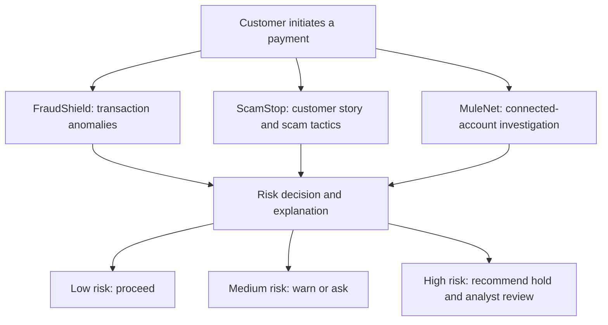
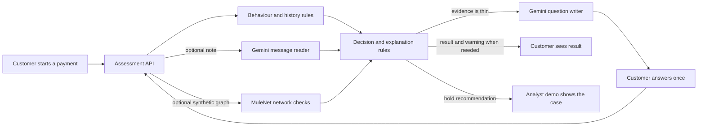
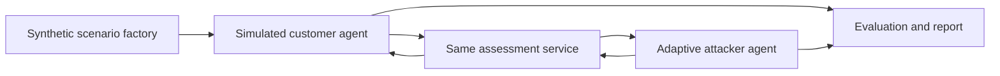

# FinGuard AI

**Agentic Financial Crime Prevention Platform.** The product combines **FraudShield + ScamStop + MuleNet** to investigate a payment before settlement and recommend a defensible action. The repository is still named `scamguard` because it began as the ScamStop/Last Mile Guard prototype. It was built for the Google Cloud AI Builder Cup 2026, banking, financial services and insurance track.

The current prototype uses made-up payments and customer stories. It does not connect to a bank, stop a real payment, or use real customer data. See [the pitch idea](docs/PITCH_IDEA.md) for the product story.

**In one sentence:** FinGuard AI combines transaction anomalies, signs of customer manipulation, and connected-account evidence so a bank can assess risk and intervene before money moves.

## The three parts

| Part | What it investigates | Current repository status |
| --- | --- | --- |
| **FraudShield** | Transaction anomalies: amount, timing, device, payee, and recent behaviour. | **Partial:** explainable rule-based scoring exists in `backend/risk/behaviour.py`; a separate fraud agent and bank-fed history do not. |
| **ScamStop** | Authorised-payment scams: pressure, secrecy, coaching, and the customer's explanation. | **Prototype implemented:** Gemini reads the note and answer, one follow-up round can be asked, and rules recommend an action. |
| **MuleNet** | Connected accounts and possible money-mule movement around the destination account. | **First synthetic slice implemented:** a bounded request-supplied transfer graph checks flagged links, many inbound senders, and rapid onward movement. No bank graph source or production network model exists. |

These findings feed a **Risk Decision and Explanation** layer that weighs evidence, recommends low/medium/high risk treatment, and gives an analyst the reasons. The current decision code combines all three when synthetic network data is supplied, while retaining the original two-signal path otherwise. The bank, not an AI agent, would make the final payment-control decision.

### Target end-to-end workflow



This is the **target product flow**, not a claim that all three modules work today. The diagram below shows the current prototype.

## Current prototype: transaction, scam, and synthetic network checks

An authorised payment can look legitimate to a bank even when a scammer has coached the customer into sending it. Transaction anomalies alone may miss the pressure, secrecy, or false story behind the payment.

For example, a customer may be about to transfer money to a new account after a caller claiming to be from the bank tells them to act immediately. The payment is authorised by the customer, but the note, new payee, unusual timing, and live call together give the bank a reason to pause and ask more. ScamGuard aims to catch that situation before the transfer is released while letting ordinary payments through.

The current ScamGuard prototype checks a payment at that last step:

1. **Read the payment context.** Evaluate the amount, payee, device, timing, recent payments, and optional 15-day spending and payee history supplied with the request.
2. **Read the customer's words.** If a short note is supplied, Gemini produces a structured reading of scam signals and the customer's relationship with the payee. A local scam-pattern guide supplies relevant advice.
3. **Investigate account links when supplied.** MuleNet examines a small synthetic transfer graph for links to flagged accounts, multiple recent senders, and fast onward transfers.
4. **Ask once when evidence is thin.** Gemini can write one or two neutral follow-up questions. The answer is assessed together with the first note.
5. **Recommend and explain.** Testable rules combine the available signals into **allow**, **warn**, or **hold for human review**. The response includes a score, ranked reasons, a customer warning where relevant, and an audit breakdown. The application only recommends an action; a bank would remain responsible for payment control and analyst review.

The web demo includes a live assessment console, a simulated analyst queue, a red-team run, an evidence page, and an architecture view. The analyst queue lives in browser state and is not a persistent bank case-management system.

## Current assessment and agent flow

The payment assessment is **one service with two Gemini-assisted tasks**, not a set of agents voting on a payment. The **message reader** extracts structured facts from the customer's note or answer. The **question writer** produces one or two short questions only when the rules say more context is needed. FraudShield and MuleNet use explainable rules; the decision code combines the available evidence. Gemini does not directly approve or hold a payment.



The browser sends one payment at a time to `POST /api/assess`. One demo case includes a synthetic account graph. If the service asks questions, the browser sends the original note, questions, answer, and graph back for a second assessment. The API keeps no conversation database. A real bank would source network evidence from trusted systems and make the actual payment and hold decisions; the current analyst screen only simulates that review.

### Agents used to test the guard

These agents are **test actors**, not part of a customer's payment decision. The scenario factory builds made-up scam and genuine cases. A simulated customer agent writes the note and, when asked, an answer. A separate adaptive attacker agent tries alternative scam wording against the deployed demo. The evaluator compares the guard's responses with the hidden scenario labels and reports missed scams and false alarms. The guard does not receive those labels.



The website's live arena uses the scenario factory and simulated customer agent in `backend/arena.py`. The adaptive attacker in `redteam/attacker.py` is run separately by the red-team tools; it is not a live production agent.

## Google Cloud architecture

### Implemented prototype

The React browser demo calls the FastAPI service on Cloud Run. The service applies local transaction and network rules and calls Gemini through Vertex AI for the two text tasks shown above. Cloud Run serves both the API and built web app from one container. `POST /api/arena` streams a live synthetic red-team run, and `GET /api/health` provides a health response. Cloud Build builds the container during source deployment.

### Recommended bank integration

The proposed next architecture connects a bank's payment event stream to **Pub/Sub**, obtains governed transaction, payee, and account-link history from **BigQuery** or another approved bank source, and calls the assessment service before the bank decides whether to release a payment. The bank's authenticated workflow would present warnings, route holds to an analyst, and retain the decision and audit record under its data-governance rules. This integration, persistent analyst queue, and production controls have **not** been implemented in this repository.

## Google technology and responsibilities

| Technology | Role in this project | Status |
| --- | --- | --- |
| **Gemini via Vertex AI** | Read a customer note and follow-up answer into a fixed schema; draft up to two short follow-up questions in one round. Rules make the final recommendation. | Implemented in the backend when `USE_VERTEX=1` and Google Cloud access is configured. |
| **Cloud Run** | Run the FastAPI service and serve the React build in one container, with instance and request limits. | Container and deployment script included. |
| **Cloud Build** | Build the container on Google Cloud from source for the Cloud Run deployment. | Used by the source-deploy workflow in `infra/deploy.sh`; no automatic GitHub CI pipeline is included. |
| **Google Cloud service account** | Let the Cloud Run service call Vertex AI using its runtime identity rather than a key file. | Supported by the client and deploy script; the account and permissions must be set up in the target project. |
| **Pub/Sub** | Carry payment events from a bank payment workflow to the assessment flow. | Proposed integration; not used by the prototype. |
| **BigQuery** | Supply governed transaction, payee, and account-link history for behavioural and network checks and evaluation. | Proposed integration; the prototype receives history and synthetic network data in each request instead. |

Local development can call Gemini with a `GEMINI_API_KEY` from an ignored `.env` file. The Cloud Run configuration uses Vertex AI and the service identity. The current scam-pattern guide is a versioned JSON file in `data/typologies.json`; there is no deployed search index or database in the assessment path.

## Tech stack

- **Web:** React, TypeScript, Vite, and Vitest in `web/`.
- **API:** Python, FastAPI, Pydantic, and Uvicorn in `backend/`.
- **AI:** Google Gen AI Python SDK for structured Gemini responses; Vertex AI in the Cloud Run configuration.
- **Risk engine:** Python rules for behavioural and synthetic network signals, corroboration, scoring, and explanations in `backend/risk/`.
- **Deployment:** Multi-stage Docker build and `gcloud run deploy --source` in `infra/deploy.sh`.
- **Evaluation:** Synthetic cases, Python evaluation scripts, red-team tools, Pytest, and web unit tests.

## Safety and current limits

- The demo uses synthetic data. The Gemini client blocks text that resembles an email address or payment-card number before sending it to the model.
- Customer text is treated as untrusted input. Model output is constrained to a schema; scoring and action thresholds remain in testable code.
- The API validates input size and fields, limits requests and Gemini calls, and falls back to non-LLM transaction and network rules if the model is unavailable or the call budget is exhausted.
- The analyst queue and its actions are a browser simulation. There is no persistent audit store, bank identity integration, or live payment hold mechanism.
- Results on synthetic and red-team cases are shown in the app's Evidence page. They do not establish performance on bank data or production readiness.

## Next implementation priorities

1. **Trusted evidence and identity:** bind the destination account to an authenticated payment event, obtain transfer links and history from bank-owned systems, and remove request-supplied network evidence from the production path.
2. **Validation and calibration:** test the combined FraudShield, ScamStop, and MuleNet score on held-back fraud, scam, mule, and legitimate cases; measure missed harm and unnecessary holds before setting bank thresholds.
3. **Operational workflow:** add authenticated analyst review, a durable case and audit store, and a bank-controlled hold/release integration. Keep all three modules' evidence visible to reviewers.
4. **Google Cloud integration:** implement the proposed Pub/Sub ingestion and governed BigQuery history lookup, then add deployment controls, observability, and automated CI checks.

## Run locally

From the repository root, create an ignored `.env` from `.env.example` and set `GEMINI_API_KEY` if you want message reading. Then run the API and web development server in separate terminals:

```bash
python -m pip install -r backend/requirements.txt
python -m uvicorn backend.app:app --reload --port 8080
```

```bash
cd web
npm ci
npm run dev
```

Vite forwards `/api` requests to the local API on port 8080. Without Gemini credentials, the API can still return a payment-only recommendation when the model call fails.

Run the test suites with `python -m pytest backend/tests` and, from `web/`, `npm test`.

## Deploy the prototype

The provided script builds from source and deploys to Cloud Run:

```bash
PROJECT_ID=your-project-id bash infra/deploy.sh
```

Before running it, configure the Google Cloud project, required APIs, and the `lmg-runtime` service account with permission to call Vertex AI. Review the script's public access, region, resource caps, and cost settings for your environment. This deploys a **public synthetic-data demo**, not a bank production service.

## Repository layout

| Path | Contents |
| --- | --- |
| `backend/` | API, Gemini client, risk engine, and backend tests |
| `web/` | Active React demo and web tests |
| `data/` | Synthetic scenarios and the scam-pattern guide |
| `eval/` | Behaviour, message, flow, blind, and parity evaluations |
| `redteam/` | Synthetic attacker, customer, and reporting tools |
| `infra/` | Cloud Run deployment and result-export scripts |
| `docs/` | Pitch and design assets |

`frontend/` is a placeholder directory; the active interface is in `web/`.
